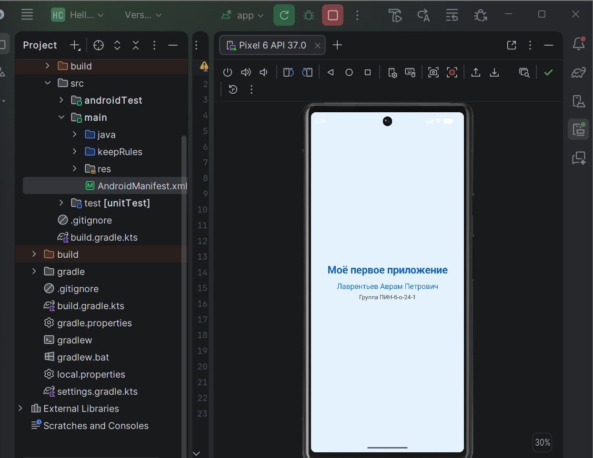

# Hello Compose — первое приложение на Jetpack Compose

## Описание проекта
Простое Android-приложение для знакомства с Jetpack Compose — современным инструментом разработки интерфейсов Android.

## Скриншоты

## Технологии
- **Язык:** Kotlin
- **UI-фреймворк:** Jetpack Compose
- **IDE:** Android Studio
- **Минимальная версия Android:** API 24 (Android 7.0)

## Установка и запуск
1. Откройте проект в Android Studio.
2. Дождитесь синхронизации Gradle.
3. Запустите эмулятор Pixel 6.
4. Нажмите Run .

## Структура проекта
- `app/src/main/java/com/example/hello/MainActivity.kt` — основной код приложения.
- `app/build.gradle.kts` — настройки и зависимости проекта.
- `app/src/main/AndroidManifest.xml` — манифест приложения.

## Автор
Лаврентьев Аврам Петрович

## Группа
ПИН-б-о-24-1
